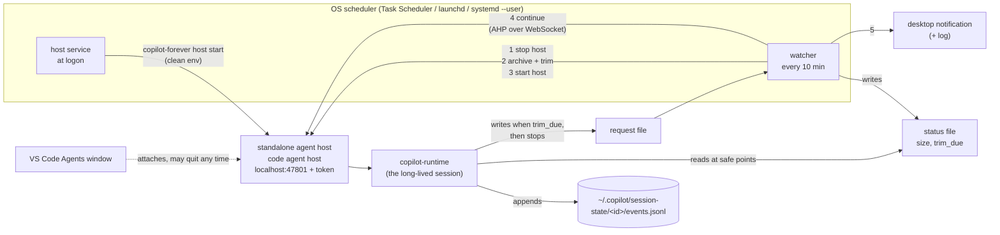

# copilot-forever

**An AI dev team that runs for days, entirely in GitHub Copilot.** Give it a goal, approve one plan, and a Copilot Orchestrator agent files the GitHub issues, has a Builder implement them, has a Diff Reviewer on a different model family check every change, gates each batch with your own test suite, and opens pull requests. It runs either as one live session that keeps going across VS Code restarts and through its own log trims, or as a Ralph-style loop of fresh `copilot -p` runs.

By **Sean Galliher**. MIT licensed.

> **Headline demo: [LoopBoard](demo/README.md).** A local-first kanban board built from an empty repository (`seangalliher/loopboard`) in a few hours of loop time. The only human input is the goal and one plan approval. The [video script](demo/VIDEO-SCRIPT.md) walks through the whole solution.

The core is the **agent team**: an Architect that plans and files issues, a Builder, a Diff Reviewer on a different model family, and an Orchestrator with review rounds and one receipted test gate per batch. It runs in either of two modes (see [Persistent session or Ralph loop?](#persistent-session-or-ralph-loop)). The repository has two layers; use the first on its own, or both together:

| Layer | What it does | Where |
|---|---|---|
| **Keep-alive kit** | Keeps **one** long-lived Copilot agent session running for days: a standalone VS Code agent host that survives editor restarts, automatic `events.jsonl` trims at safe points the agent chooses, followed by an automatic continue, and an automatic continue after a network drop. | this README, `bin/`, `src/` |
| **Goal loop** | Four Copilot custom agents (Orchestrator, Architect, Builder, Diff Reviewer), shared standing orders, a receipted test gate and a handoff file, with safe defaults: plan approval, caps, a STOP file, PRs only. Runs as a persistent session (on the keep-alive kit) or as a Ralph loop (`copilot-forever loop --mode ralph`, no kit needed). | [templates/goal-loop](templates/goal-loop/README.md), [Orchestrator map](docs/orchestrator-map.md) |

On a new machine, one command clones the kit, installs it, and renders the goal loop into your repository:

```bash
git clone https://github.com/seangalliher/copilot-forever.git && node copilot-forever/bootstrap.mjs --repo path/to/your-repo
```

The rest of this README covers the keep-alive kit. The goal loop is documented in [templates/goal-loop/README.md](templates/goal-loop/README.md), and the [Orchestrator map](docs/orchestrator-map.md) shows how it works end to end: every phase, role, decision point and handoff, with diagrams.

## The keep-alive kit

It does three jobs:

1. **Keeps the session alive when VS Code quits.** It runs the session on a *standalone* VS Code agent host bound to localhost, which the OS starts at logon. VS Code attaches to that host instead of owning it.
2. **Keeps the session's event log small enough to resume.** At a safe point the agent chooses itself, a watcher stops the host, trims `events.jsonl` to the latest successful compaction (archiving the full log first), restarts the host, and tells the agent to continue over the open [Agent Host Protocol](https://github.com/microsoft/agent-host-protocol).
3. **Resumes the session when it stops on its own.** When a turn dies on a network error (DNS, connection refused, a timeout, a 5xx from the model API), Copilot retries for a few seconds and then ends the turn, and the session sits idle until someone types. The watcher notices, waits until the model API answers again, and sends a continue. It also continues a session that ended its turn to wait on background work and was never woken. See [Network resume](#network-resume) and [Stall resume](#stall-resume).

> **Status: reference implementation in validation.** The machine-specific scripts this kit was ported from (Windows, PowerShell and Python) run a real orchestrator today. Every part of them has been exercised except two: a full automatic trim cycle (stop, trim, restart, then continue to a just-reloaded session) has not yet completed on the real session, and network resume has been tested on a copy of a real failed log but not yet on a live network drop. This Node port passes its own tests on Windows, including that full cycle against a fake host. Its first real trim is the first end-to-end proof. If that continue fails, the notification asks you to send "continue" by hand, and the session is intact either way. The goal loop's agents have not yet completed a full run; the demo run is their first.

## The problem

**VS Code's built-in agent host dies with the editor.** The built-in ("editor") agent host starts each session's `copilot-runtime` as a child of `Code.exe`. Quitting VS Code to install an update, or to free the window's memory (several GB after a day of one long chat), ends the session. A long-running orchestrator then needs a handover to a new session.

**A long `events.jsonl` breaks resume.** Copilot appends every event of a session to `~/.copilot/session-state/<id>/events.jsonl` and never shrinks it. A busy orchestrator adds about 10 MB an hour (300 MB in 30 hours). Large logs cause known failures:

| Issue | What happens |
|---|---|
| [github/copilot-cli#4325](https://github.com/github/copilot-cli/issues/4325) | The session becomes permanently unloadable once `events.jsonl` exceeds V8's maximum string length (closed). |
| [github/copilot-cli#4664](https://github.com/github/copilot-cli/issues/4664) | The CLI crashes with "JavaScript heap out of memory" when resuming a long-standing session (closed). |
| [github/copilot-cli#2609](https://github.com/github/copilot-cli/issues/2609) | `events.jsonl` mutex timeouts and stale `inuse.*.lock` files after a long-lived session grows large. |
| [github/copilot-cli#3907](https://github.com/github/copilot-cli/issues/3907) | CPU at maximum in a long-running session, and data lost when the agent "backed up" the log with a hard link before truncating it. |
| [github/copilot-cli#4663](https://github.com/github/copilot-cli/issues/4663) | A failed compaction is retried on every turn and the context keeps growing. A failed compaction is also why the trim only ever cuts at a compaction with `success: true`. |

Trimming at the latest compaction is safe in principle: after a compaction, the model's context is the compaction summary plus everything after it. Older events are history the model no longer reads.

## How it works



**Every watcher run** (default: every 10 minutes) finds the session and writes the status file:

```json
{
  "session_id": "c0314129-…",
  "ahp_session": "ahp-session:/9f1e…",
  "size_mib": 412.3,
  "threshold_mib": 400,
  "trim_due": true,
  "checked_at": "2026-11-04T10:20:00Z",
  "how_to_request": "…"
}
```

The session is the `session-state` folder whose `workspace.yaml` names your repo as its `cwd` and whose live `inuse.<pid>.lock` PID runs under the standalone host's process tree. Its AHP URI is taken from `code agent ps --json` while the agent works, kept from the last status file while it is idle, or looked up with the AHP `listSessions` command.

**The agent** (see [agent/snippet.md](agent/snippet.md)) reads the status file at every safe point, meaning nothing it started is still running. When `trim_due` is true, it writes a handoff addendum, writes the request file and stops.

**A trim run** happens only when the request file exists. In order:

1. The session must be idle on two checks `idleRecheckSeconds` apart: not listed as active by the host, the log unwritten for `quietSeconds`, and the last turn ended. The host can keep listing a session as running after its turn ended (seen on a real host: a requested trim waited over 2 hours on it). The watcher never overrides the host. Instead, when the listing says running but the log's last turn ended `staleHostMinutes` ago, it notifies you once (not when that turn ended on an `ask_user` question; a question asked in plain text is not detected): open the chat and, if it shows as running with no question or background work pending, press Stop.
2. Safety checks run before anything is stopped: the Copilot version, the log layout, and whether a successful compaction exists to cut at. If any check refuses, nothing is stopped or changed. The request is archived, the agent is told to continue (the message says the trim did not happen), and you are notified.
3. The watcher stops the host's process tree and waits for the session's runtime to exit, which releases the lock.
4. It trims the log. The full log is first copied to `~/.copilot/session-archive/<id>/events-<UTC>.jsonl`. The trim keeps the session-start header events and every event from the latest `session.compaction_start` whose `session.compaction_complete` has `data.success == true`. An event whose parent was cut is re-parented onto the last header event. The new log is written to a temp file and renamed over the old one, then read back and checked. If the check fails, the archive is restored.
5. It starts the host again, through the installed service, so the host gets the scheduler's fresh environment.
6. It moves the request to `trim-history/` and rewrites the status file, so the resumed agent never reads a stale `trim_due`.
7. It sends the continue message over AHP: `initialize`, `subscribe` to the session, `subscribe` to its default chat, then dispatch `chat/turnStarted`. The turn reuses the model and custom agent of the chat's last user message. If the chat has no earlier user message, it uses your agent file. The send refuses if the chat is busy or names a different custom agent. It counts as done only when the agent starts responding. It retries up to 3 times.
8. It shows a desktop notification: trimmed and resumed, trimmed but resume needed, or needs attention.

If the trim fails, the host is still restarted with the session intact, and the agent is told to continue.

### Network resume

On every run with no trim request, the watcher also checks the end of the session log. It sends a continue only when all of these hold:

- The last turn ended in a `session.error` whose message is a network error (DNS, `ECONNREFUSED`, `ECONNRESET`, a timeout, 500/502/503/504), and the session hasn't worked since.
- The error isn't an auth, quota, rate-limit, content-policy or cancel error, or anything unrecognised. Those need you; the watcher logs once that it won't resume and leaves the session alone.
- The error is at least `resume.quietMinutes` old, the log has been quiet that long, and the session is idle on the host.
- The model API's host (taken from the error message) resolves and accepts a connection. While it doesn't, the watcher just checks again next run.

The message tells the agent when the error happened and to check where it was (git state, running work, the handoff) before resuming. Each error gets at most `resume.maxTries` continues, `resume.retryMinutes` apart, and there are at most `resume.maxPerDay` continues across all errors in 24 hours, so an API that accepts connections but fails every turn can't cause an endless loop. After that one notification asks you to step in. Set `resume.enabled` to `false` to turn it off.

### Stall resume

An agent that starts background work (a shell with `mode: "async"`, a task with `mode: "background"`) usually ends its turn and is woken by a system notification when that work finishes. If the notification never arrives, the session sits idle until someone types. This has been seen on a real standalone host: after a network error, no completion notification was delivered for the rest of the session, and the orchestrator waited 5.5 hours on a consult that had finished in 17 minutes.

On every run with no trim request, the watcher sends a continue when all of these hold:

- The last working turn (the last turn that called tools) launched background work, and the session hasn't worked since.
- That turn didn't call `task_complete` or `ask_user` (a deliberate stop), and the log doesn't end in an error (network resume handles those).
- The log has been quiet for `stall.quietMinutes`, or for the longest `Start-Sleep` in that turn plus 5 minutes if that is longer, and the session is idle on the host.

The message says when the agent stopped and which work it was waiting on, and tells it to check that work's output and to wait in the foreground for anything still running. Each stall gets at most `stall.maxTries` continues, and there are at most `stall.maxPerDay` across all stalls in 24 hours; then one notification asks you to step in. Set `stall.enabled` to `false` to turn it off.

This came from a real run: a DNS failure at 09:34 stopped an orchestrator that then sat idle for more than six hours until a person noticed.

## Setup

Requirements: Node 22 or newer (the built-in WebSocket is used), VS Code stable with the `code` CLI on PATH, and Copilot in VS Code's Agents window. The Copilot CLI is optional; if it is installed, its version is checked.

Clone this repository and install it as a command:

```bash
git clone https://github.com/seangalliher/copilot-forever.git
```

```bash
cd copilot-forever && npm ci && npm link
```

(Without `npm link`, use `node bin/copilot-forever.mjs` wherever `copilot-forever` appears below. Keep the clone where it is: the scheduled tasks run it from there.)

**1. Configure.** Run this in the folder where you want the config file to live:

```bash
copilot-forever init --repo /path/to/your/repo
```

This writes `copilot-forever.config.json` and creates the connection token at `~/.copilot-forever/token.txt`, readable by your user only. Edit the config as needed; see [Configuration](#configuration).

**2. Teach the agent.** Paste the output of the next command into your custom agent file (for example `.github/agents/orchestrator.agent.md`). It is [agent/snippet.md](agent/snippet.md) with your configured paths filled in.

```bash
copilot-forever snippet --config copilot-forever.config.json
```

Add the files the kit writes to `.gitignore` (by default `logs/session-log-status.json`, `logs/trim-request.json`, `logs/trim-history/`). Keep the handoff file wherever suits you.

**3. Check.**

```bash
copilot-forever doctor --config copilot-forever.config.json
```

**4. Install the schedule.** Run it from an ordinary terminal, not from inside an agent's shell.

```bash
copilot-forever install --config copilot-forever.config.json
```

| OS | What `install` creates |
|---|---|
| Windows | Task Scheduler tasks **copilot-forever host** (at logon, after 30 s) and **copilot-forever watch** (every N minutes, no overlapping runs). Both run as you, interactive, least privilege, through Windows PowerShell in a headless console (no window). |
| macOS | launchd agents `local.copilot-forever.host` (RunAtLoad, no KeepAlive) and `local.copilot-forever.watch` (StartInterval) in `~/Library/LaunchAgents`. |
| Linux | systemd user units `copilot-forever-host.service` (enabled, `Type=simple`, runs `host start --foreground`) and `copilot-forever-watch.timer` (enabled and started). For the host to run without an open login session, run `loginctl enable-linger` yourself. |

Start the host now (otherwise it starts at your next logon):

```bash
copilot-forever host start --config copilot-forever.config.json
```

**5. Point VS Code at the host.** Add the standalone host to VS Code's remote agent hosts (the `chat.remoteAgentHosts` user setting; see VS Code's documentation for its current format) with address `localhost:47801` and the token from the token file. Then, in the Agents window, start a **new** session on that host with your repo folder and custom agent.

The standalone host lists its own sessions only. An existing session from VS Code's editor host cannot be moved onto it, so moving to the standalone host costs one last handover: have the old session write a handoff and stop, then start the new session from that handoff.

**6. Check it survives.** Quit VS Code completely while the agent works, then reopen it. The session keeps running, and `copilot-forever host status` shows it.

To remove the schedule:

```bash
copilot-forever uninstall --config copilot-forever.config.json
```

Uninstall leaves a running host running, because stopping the host stops the agent. Add `--stop-host` to stop it too.

## Commands

Every command accepts `--config <file>` and `--dry-run`. With `--dry-run`, every check runs but nothing is written, stopped, trimmed, started or sent.

| Command | What it does |
|---|---|
| `init --repo <folder>` | Writes a starter config and creates the token file. |
| `doctor` | Read-only checks: config, the `code` CLI, Copilot versions, the token file's permissions, installation, port, host, session, log layout and whether a trim point exists. |
| `host start [--foreground] [--direct]` | Starts `code agent host --host localhost --port <port> --connection-token-file <token> --new-instance` with a clean environment, unless the port is already listening. With the schedule installed (and `host.startVia` `auto`) it asks the host service to start it; `--direct` spawns it here instead, for this run only (`host.startVia: direct` does that always). The Windows host task uses `--direct`. `--foreground` supervises it (used by systemd and launchd). |
| `host stop` / `host status` | Stops the standalone host's process tree (and with it the session's runtime) or shows it. |
| `watch [--force]` | One watcher run, as described above. `--force` accepts an untested Copilot version; the log layout is always checked. |
| `trim <session-id> [--copy <new-id>]` | Trims a stopped session by hand. `--copy` writes a trimmed copy under a new session id and leaves the source untouched. It refuses while a process in `inuse.<pid>.lock` is alive. |
| `continue [--session <uri>] [--text <msg>] [--probe]` | Sends the continue message (by default to the status file's `ahp_session`). `--probe` is read-only and prints the session's and chat's state. |
| `install` / `uninstall [--stop-host]` | Manages the OS schedule. |
| `snippet` | Prints the agent-side instructions with your paths filled in. |
| `report [--session <id\|path>] [--out <file>] [--json]` | Read-only timing report from the session log (and its trim archives): where the time went (subagents, Orchestrator, waiting for a message, waiting on background commands, quiet, stopped), per role and per subagent run, with effort, model and tool time, tokens and Copilot's usage figures. Without `--session` it reports on the session in the status file, else the newest session in `repoFolder`. A path needs no config; archives then come from `<COPILOT_HOME>/session-archive`. |

Logs: `~/.copilot-forever/logs/copilot-forever.log` (the kit) and `host-<instanceName>.log` (the host's own output, with the token masked).

## Configuration

`copilot-forever.config.json` is found at `--config`, then `$COPILOT_FOREVER_CONFIG`, then `./copilot-forever.config.json`, then `~/.copilot-forever/config.json`. Only `repoFolder` is required. Relative paths under `files` and `agentFile` resolve against `repoFolder`; other relative paths resolve against the config file's folder. `~` is expanded. [copilot-forever.config.example.json](copilot-forever.config.example.json) lists every key with its default.

| Key | Default | Meaning |
|---|---|---|
| `repoFolder` | (required) | The folder the session works in (its `cwd`). |
| `agentFile` | `.github/agents/orchestrator.agent.md` | Your custom agent. The continue step refuses if the chat's last message names a different agent, and uses this agent when the chat has no earlier user message. |
| `instanceName` | `copilot-forever` | Names the scheduled tasks and units. Change it to run a second instance (with another port). |
| `copilotHome` | `$COPILOT_HOME` or `~/.copilot` | Where `session-state/` lives. |
| `stateDir` | `~/.copilot-forever` | Token, logs, lock. |
| `host.codeCommand` | `code` | The VS Code CLI: a command name or `[executable, ...args]` (for example `code-insiders`). |
| `host.port` | `47801` | Localhost port of the standalone host. |
| `host.tokenFile` | `<stateDir>/token.txt` | Connection token, created owner-only if missing. |
| `host.passEnv` | `[]` | Extra environment variables to pass to the host (see Security). |
| `host.startVia` | `auto` | `auto` starts the host through the installed service; `direct` always spawns it. |
| `trim.thresholdMiB` | `400` | `trim_due` becomes true at this log size. |
| `trim.archiveDir` | `<copilotHome>/session-archive` | Where full logs are archived before a trim. |
| `watch.intervalMinutes` | `10` | Watcher schedule. |
| `watch.quietSeconds` / `idleRecheckSeconds` | `120` / `90` | Idle detection. |
| `watch.staleHostMinutes` | `30` | Notify when the host still lists the session as running although its last turn ended this long ago. `0` turns it off. |
| `watch.continueTries` / `continueTimeoutSeconds` | `3` / `180` | Continue attempts, and how long to wait for the agent to start working. |
| `files.status` / `request` / `history` / `handoff` | `logs/…` | The files shared with the agent. |
| `continueText` | (see example) | The continue message; `{handoff}` is replaced with the handoff path. |
| `resume.enabled` | `true` | Network resume on or off. |
| `resume.quietMinutes` / `retryMinutes` / `maxTries` / `maxPerDay` | `15` / `20` / `3` / `8` | How old the error must be, the gap between continues, the continues per error, and the continues across all errors in 24 hours. |
| `resume.apiHost` / `apiPort` / `probeTimeoutSeconds` | from the error / `443` / `5` | The model API reachability check. |
| `resume.text` | (see example) | The resume message; `{time}` is the error time and `{handoff}` the handoff path. |
| `stall.enabled` | `true` | Stall resume on or off. |
| `stall.quietMinutes` / `maxTries` / `maxPerDay` | `20` / `2` / `24` | The quiet time before a continue (at least the longest watchdog sleep plus 5 minutes), the continues per stall, and the continues across all stalls in 24 hours. |
| `stall.text` | (see example) | The stall message; `{time}` is when the turn ended and `{work}` the background work it launched. |
| `notify` | `true` | Desktop notifications (always logged as well). |
| `copilot.supportedMajors` / `knownLogVersions` | `[1]` / `[1]` | Version and log-layout gates; see Safety. |

## Safety

- **Version check.** A trim refuses if `copilot --version` or the session's runtime version (from the log header) has a major version other than `copilot.supportedMajors`. `--force` overrides this for one run.
- **Log-schema check.** Before anything is stopped, the whole log is parsed and checked. The first event must be `session.start` with a known `data.version` and the session's own id. Every event must have a `type`, a unique string `id`, and a `parentId` that is a string or null. Every `session.compaction_complete` must carry a boolean `data.success`. Anything else refuses the trim, and nothing is changed.
- **Only safe cut points.** The cut is the latest compaction whose completion has `success: true`. A failed compaction ([#4663](https://github.com/github/copilot-cli/issues/4663)) or one still in progress is never used.
- **Archive first, atomic replace, verify.** The full log is copied (and size-checked) before the trim. The trimmed log replaces the original by rename. It is then read back and checked, and the archive is restored if the check fails. The trim also refuses if the log changed while it was being read.
- **Never on a live session.** The trim refuses while any PID named in an `inuse.<pid>.lock` file is alive.
- **Dry run everywhere.** `--dry-run` works on every command.
- **One run at a time.** The watcher takes a lock file; overlapping scheduler runs skip.

## Limits

- **`events.jsonl` is an internal, undocumented format.** It can change in any Copilot release. The schema check is the guard: when the layout changes, the trim refuses rather than guessing. The check matches the logs of Copilot CLI 1.0.x and of VS Code's bundled runtime (1.0.10x) as of November 2026.
- **The Agent Host Protocol is pre-production.** The spec is public and versioned (1.1.0 at the time of writing), but VS Code's standalone `code agent host` is new. The `code agent ps --json` output this kit reads is not a documented interface.
- **Trims only shrink sessions that have compacted.** A session that has never completed a compaction cannot be trimmed.
- **One session per repo folder.** If several sessions under the host work in the same folder, the largest log wins.
- **Windows:** Task Scheduler starts node through Windows PowerShell inside `conhost.exe --headless`, so no console window appears. (`-WindowStyle Hidden` alone lets a window flash on every run.) After upgrading the kit, run `install` again to update existing tasks.
- **Linux/macOS:** desktop notifications need `notify-send` or `osascript` and a desktop session. Otherwise they appear only in the log.

The goal loop adds its own:

- **Agents follow instructions; they are not enforced by code.** Caps, the STOP file, plan approval and the merge policy are rules in the agent files. The gate script, the reviewer-family check in bootstrap, branch protection on GitHub and the PR-only workflow are the hard guards. Turn on branch protection for the default branch (require a PR and passing checks) so a misbehaving agent cannot push to it.
- **Model ids change.** The default models in the config are the ones tested at the time of writing. Check that your Copilot plan offers them, and pick a reviewer from a different vendor than the builder.
- **Not yet proven end to end.** The goal-loop templates are distilled from a loop that ran for months, but this generic version has not yet completed a full run. The demo run is its first; expect to tune the agent files after it.
- **Cost.** A loop that runs for hours uses premium requests continuously. Watch your Copilot usage on the first runs, and keep `caps.maxBatchesPerRun` low until you know your rate.

## Persistent session or Ralph loop?

A **Ralph loop** is a `while` loop that runs the agent with a fresh context each time: every run starts cold, reads its state from files, does one unit of work and exits. GitHub's [awesome-copilot](https://github.com/github/awesome-copilot/tree/main/cookbook/copilot-sdk) has Ralph loop recipes for the Copilot SDK in five languages (`ralph-loop.md` in each language folder). They are the prior art for the goal loop's Ralph mode.

The goal loop runs either way. The **agent team is the same in both**: the Architect's plan and issues, the Builder, the cross-family Diff Reviewer with up to three review rounds, the Orchestrator's batching, one receipted gate per batch, one PR per batch, verified closure. What differs is what carries the Orchestrator from one batch to the next.

| | Persistent session | Ralph loop |
|---|---|---|
| How it runs | One Orchestrator session in VS Code's Agents window, on the standalone host | `copilot-forever loop --mode ralph`: a fresh `copilot -p` Orchestrator run per step (plan, file issues, one batch) |
| Memory between batches | The session's own context (summarised by compaction) plus the handoff file | The handoff file and the GitHub issues only |
| Watching and steering | Live: read the chat, type a correction, answer a question | After the fact: the run log, transcripts, PRs; steer by editing files or issues between runs |
| Plan approval | Reply `APPROVE PLAN` in the chat | `copilot-forever loop approve-plan` (bound to the plan's hash) |
| Survives VS Code quitting | Yes, through the standalone host | Not affected: it does not use VS Code |
| Log growth | Needs copilot-forever's trim | None: each run's log is small and thrown away |
| Depends on Copilot internals | Yes: `events.jsonl` layout, the Agent Host Protocol, `code agent ps` | No: only the Copilot CLI's documented flags |
| Tool approvals | As configured in the VS Code session | `--allow-all-tools` (required for non-interactive runs), with deny rules |
| Moving parts | Host service, watcher, trim, AHP client | One Node process and `copilot` |

**Ralph is simpler and more robust.** It is immune to log growth and to changes in Copilot's internal formats, a crash costs one run, and there is nothing to keep alive. **The persistent session is more present.** It is one live session you can watch and steer in VS Code, it remembers what went wrong earlier in the run, and copilot-forever keeps it alive across editor restarts and log growth.

The difference is smaller than it looks. A trim is effectively a soft restart: the session continues from its latest compaction summary, which is what Copilot's own compaction already does when the context fills. The persistent session keeps a little more than a Ralph run (the summary, the chat, the session's settings), and costs the keep-alive machinery.

Pick Ralph mode for unattended runs on a build machine or in a sandbox, or if you do not want to depend on Copilot internals. Pick the persistent session when you want to watch and steer.

## Security notes

- **Archived logs hold full transcripts.** Everything in `~/.copilot/session-archive/` is a complete copy of the session: prompts, tool calls, file contents, command output, and possibly secrets that appeared in any of them. Delete old archives when you no longer need them. On macOS and Linux each session's archive folder is mode `700` and each archive `600`; on Windows they inherit your profile folder's permissions.
- **The token file grants full control of the host.** Anyone with the token can drive your agent on localhost. It is created with mode `600` on macOS and Linux, and with an ACL for your user only on Windows. It is never logged: the host's startup banner is masked in its host log, and every log line passes through redaction.
- **Localhost only.** The host is always started with `--host localhost` and a connection token. The kit never passes `0.0.0.0` or `--without-connection-token`.
- **Clean environment.** The host, and every shell the agent opens, starts with an allowlist of OS variables (PATH, HOME/USERPROFILE, temp, locale and the like) plus any names in `host.passEnv`. Variables of whatever ran the command (for example VS Code's `VSCODE_*`, `ELECTRON_RUN_AS_NODE`, `NODE_OPTIONS`, other tools' session variables, tokens in your shell) do not leak into the long-lived agent. Run `install` and `host start` from an ordinary terminal.
- **Ralph mode runs with `--allow-all-tools`.** Non-interactive Copilot runs require it, so every run can execute any command. See [Permissions](templates/goal-loop/README.md#permissions-read-this-before-the-first-run) before the first run.
- **Sandbox if you auto-approve tools.** An agent that runs unattended for days with auto-approved tools can do anything your user account can. Prefer a dedicated user account, VM, container or dev box, keep credentials it does not need out of reach, and review what it pushes.

## Tested versions

| Component | Version |
|---|---|
| Copilot CLI | 1.0.100 (and the runtime VS Code bundles, 1.0.103-unstable, as recorded in session logs) |
| VS Code | stable 1.145 (`code agent host` standalone host) |
| Agent Host Protocol | 1.1.0 negotiated with the host (1.0.0 and 0.9.0 offered as fallbacks) |
| AHP client | [`@microsoft/agent-host-protocol`](https://www.npmjs.com/package/@microsoft/agent-host-protocol) 1.0.0 |
| Node | 22 and 24 |
| OS | Windows 11: unit and end-to-end tests pass, and the reference scripts run a real session. macOS and Linux: CI (unit and end-to-end tests against the fake host, dry-run install) only; see below. |

**Not yet verified on macOS or Linux with a real host:** the launchd agents and systemd units (only generated and checked by tests), `host start --foreground` under a service manager, killing the real host's process tree, and desktop notifications. Reports are welcome.

## Development

```bash
npm ci
npm run build   # type-check (tsc over JSDoc)
npm test        # unit tests + end-to-end against a fake host
```

The tests use small synthetic `events.jsonl` fixtures ([test/fixtures](test/fixtures), regenerated by `make-fixtures.mjs`), a fake AHP WebSocket server ([test/fake-ahp-server.mjs](test/fake-ahp-server.mjs)), and a fake `code` CLI ([test/fake-code.mjs](test/fake-code.mjs)). The fake CLI runs a fake host process tree, so the end-to-end test covers the full cycle: host start, dry run, status, refusal, stop, trim, restart (after the old host's port has closed) and continue. [test/resume.test.mjs](test/resume.test.mjs) covers the network and stall resume decisions, their caps and the API check.

The goal-loop tests ([test/goal-loop.test.mjs](test/goal-loop.test.mjs)) run the gate script in temporary Git repositories (pass, fail, dirty tree, tests that change tracked files, `--verify` after a new commit), render every template, run the bootstrap dry and for real, and check that no project-specific vocabulary appears in the kit, the templates or the demo.

## License

[MIT](LICENSE) © 2026 Sean Galliher
