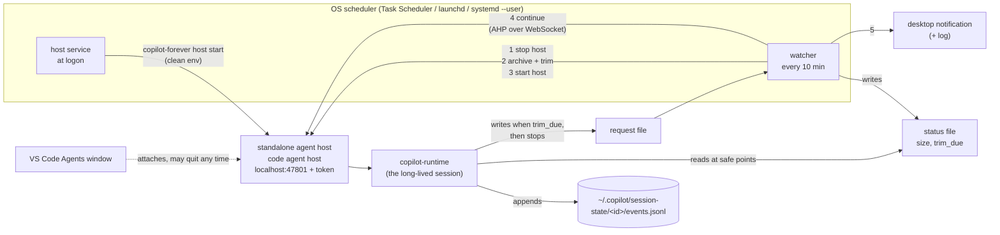

# copilot-forever

Keep **one** GitHub Copilot agent session, such as an orchestrator custom agent in VS Code's Agents window, running on its own for days.

copilot-forever does two jobs:

1. **Keeps the session alive when VS Code quits.** It runs the session on a *standalone* VS Code agent host bound to localhost, which the OS starts at logon. VS Code attaches to that host instead of owning it.
2. **Keeps the session's event log small enough to resume.** At a safe point the agent chooses itself, a watcher stops the host, trims `events.jsonl` to the latest successful compaction (archiving the full log first), restarts the host, and tells the agent to continue over the open [Agent Host Protocol](https://github.com/microsoft/agent-host-protocol).

> **Status: reference implementation in validation.** The machine-specific scripts this kit was ported from (Windows, PowerShell and Python) run a real orchestrator today. Every part of them has been exercised except one: a full automatic trim cycle (stop, trim, restart, then continue to a just-reloaded session) has not yet completed on the real session. This Node port passes its own tests on Windows, including that full cycle against a fake host. Its first real trim is the first end-to-end proof. If that continue fails, the notification asks you to send "continue" by hand, and the session is intact either way.

## The problem

**VS Code's built-in agent host dies with the editor.** The built-in ("editor") agent host starts each session's `copilot-runtime` as a child of `Code.exe`. Quitting VS Code to install an update, or to free the window's memory (several GB after a day of one long chat), ends the session. A long-running orchestrator then needs a handover to a new session.

**A long `events.jsonl` breaks resume.** Copilot appends every event of a session to `~/.copilot/session-state/<id>/events.jsonl` and never shrinks it. A busy orchestrator adds about 10 MB an hour (300 MB in 30 hours). Large logs cause known failures:

| Issue | What happens |
|---|---|
| [github/copilot-cli#4325](https://github.com/github/copilot-cli/issues/4325) | The session becomes permanently unloadable once `events.jsonl` exceeds V8's maximum string length (closed). |
| [github/copilot-cli#4664](https://github.com/github/copilot-cli/issues/4664) | The CLI crashes with "JavaScript heap out of memory" when resuming a long-standing session (closed). |
| [github/copilot-cli#2609](https://github.com/github/copilot-cli/issues/2609) | `events.jsonl` mutex timeouts and stale `inuse.*.lock` files after a long-lived session grows large. |
| [github/copilot-cli#3907](https://github.com/github/copilot-cli/issues/3907) | CPU at maximum in a long-running session, and data lost when the agent "backed up" the log with a hard link before truncating it. |
| [github/copilot-cli#4663](https://github.com/github/copilot-cli/issues/4663) | A failed compaction is retried on every turn and the context keeps growing. A failed compaction is also why the trim only ever cuts at a compaction with `success: true`. |

Trimming at the latest compaction is safe in principle: after a compaction, the model's context is the compaction summary plus everything after it. Older events are history the model no longer reads.

## How it works



**Every watcher run** (default: every 10 minutes) finds the session and writes the status file:

```json
{
  "session_id": "c0314129-…",
  "ahp_session": "ahp-session:/9f1e…",
  "size_mib": 412.3,
  "threshold_mib": 400,
  "trim_due": true,
  "checked_at": "2026-11-04T10:20:00Z",
  "how_to_request": "…"
}
```

The session is the `session-state` folder whose `workspace.yaml` names your repo as its `cwd` and whose live `inuse.<pid>.lock` PID runs under the standalone host's process tree. Its AHP URI is taken from `code agent ps --json` while the agent works, kept from the last status file while it is idle, or looked up with the AHP `listSessions` command.

**The agent** (see [agent/snippet.md](agent/snippet.md)) reads the status file at every safe point, meaning nothing it started is still running. When `trim_due` is true, it writes a handoff addendum, writes the request file and stops.

**A trim run** happens only when the request file exists. In order:

1. The session must be idle on two checks `idleRecheckSeconds` apart: not listed as active by the host, the log unwritten for `quietSeconds`, and the last turn ended.
2. Safety checks run before anything is stopped: the Copilot version, the log layout, and whether a successful compaction exists to cut at. If any check refuses, nothing is stopped or changed. The request is archived, the agent is told to continue (the message says the trim did not happen), and you are notified.
3. The watcher stops the host's process tree and waits for the session's runtime to exit, which releases the lock.
4. It trims the log. The full log is first copied to `~/.copilot/session-archive/<id>/events-<UTC>.jsonl`. The trim keeps the session-start header events and every event from the latest `session.compaction_start` whose `session.compaction_complete` has `data.success == true`. An event whose parent was cut is re-parented onto the last header event. The new log is written to a temp file and renamed over the old one, then read back and checked. If the check fails, the archive is restored.
5. It starts the host again, through the installed service, so the host gets the scheduler's fresh environment.
6. It moves the request to `trim-history/` and rewrites the status file, so the resumed agent never reads a stale `trim_due`.
7. It sends the continue message over AHP: `initialize`, `subscribe` to the session, `subscribe` to its default chat, then dispatch `chat/turnStarted`. The turn reuses the model and custom agent of the chat's last user message. If the chat has no earlier user message, it uses your agent file. The send refuses if the chat is busy or names a different custom agent. It counts as done only when the agent starts responding. It retries up to 3 times.
8. It shows a desktop notification: trimmed and resumed, trimmed but resume needed, or needs attention.

If the trim fails, the host is still restarted with the session intact, and the agent is told to continue.

## Setup

Requirements: Node 22 or newer (the built-in WebSocket is used), VS Code stable with the `code` CLI on PATH, and Copilot in VS Code's Agents window. The Copilot CLI is optional; if it is installed, its version is checked.

Clone this repository and install it as a command:

```bash
git clone https://github.com/seangalliher/copilot-forever.git
```

```bash
cd copilot-forever && npm ci && npm link
```

(Without `npm link`, use `node bin/copilot-forever.mjs` wherever `copilot-forever` appears below. Keep the clone where it is: the scheduled tasks run it from there.)

**1. Configure.** Run this in the folder where you want the config file to live:

```bash
copilot-forever init --repo /path/to/your/repo
```

This writes `copilot-forever.config.json` and creates the connection token at `~/.copilot-forever/token.txt`, readable by your user only. Edit the config as needed; see [Configuration](#configuration).

**2. Teach the agent.** Paste the output of the next command into your custom agent file (for example `.github/agents/orchestrator.agent.md`). It is [agent/snippet.md](agent/snippet.md) with your configured paths filled in.

```bash
copilot-forever snippet --config copilot-forever.config.json
```

Add the files the kit writes to `.gitignore` (by default `logs/session-log-status.json`, `logs/trim-request.json`, `logs/trim-history/`). Keep the handoff file wherever suits you.

**3. Check.**

```bash
copilot-forever doctor --config copilot-forever.config.json
```

**4. Install the schedule.** Run it from an ordinary terminal, not from inside an agent's shell.

```bash
copilot-forever install --config copilot-forever.config.json
```

| OS | What `install` creates |
|---|---|
| Windows | Task Scheduler tasks **copilot-forever host** (at logon, after 30 s) and **copilot-forever watch** (every N minutes, no overlapping runs). Both run as you, interactive, least privilege, through a hidden Windows PowerShell window. |
| macOS | launchd agents `local.copilot-forever.host` (RunAtLoad, no KeepAlive) and `local.copilot-forever.watch` (StartInterval) in `~/Library/LaunchAgents`. |
| Linux | systemd user units `copilot-forever-host.service` (enabled, `Type=simple`, runs `host start --foreground`) and `copilot-forever-watch.timer` (enabled and started). For the host to run without an open login session, run `loginctl enable-linger` yourself. |

Start the host now (otherwise it starts at your next logon):

```bash
copilot-forever host start --config copilot-forever.config.json
```

**5. Point VS Code at the host.** Add the standalone host to VS Code's remote agent hosts (the `chat.remoteAgentHosts` user setting; see VS Code's documentation for its current format) with address `localhost:47801` and the token from the token file. Then, in the Agents window, start a **new** session on that host with your repo folder and custom agent.

The standalone host lists its own sessions only. An existing session from VS Code's editor host cannot be moved onto it, so moving to the standalone host costs one last handover: have the old session write a handoff and stop, then start the new session from that handoff.

**6. Check it survives.** Quit VS Code completely while the agent works, then reopen it. The session keeps running, and `copilot-forever host status` shows it.

To remove the schedule:

```bash
copilot-forever uninstall --config copilot-forever.config.json
```

Uninstall leaves a running host running, because stopping the host stops the agent. Add `--stop-host` to stop it too.

## Commands

Every command accepts `--config <file>` and `--dry-run`. With `--dry-run`, every check runs but nothing is written, stopped, trimmed, started or sent.

| Command | What it does |
|---|---|
| `init --repo <folder>` | Writes a starter config and creates the token file. |
| `doctor` | Read-only checks: config, the `code` CLI, Copilot versions, the token file's permissions, installation, port, host, session, log layout and whether a trim point exists. |
| `host start [--foreground]` | Starts `code agent host --host localhost --port <port> --connection-token-file <token> --new-instance` with a clean environment, unless the port is already listening. `--foreground` supervises it (used by systemd and launchd). |
| `host stop` / `host status` | Stops the standalone host's process tree (and with it the session's runtime) or shows it. |
| `watch [--force]` | One watcher run, as described above. `--force` accepts an untested Copilot version; the log layout is always checked. |
| `trim <session-id> [--copy <new-id>]` | Trims a stopped session by hand. `--copy` writes a trimmed copy under a new session id and leaves the source untouched. It refuses while a process in `inuse.<pid>.lock` is alive. |
| `continue [--session <uri>] [--text <msg>] [--probe]` | Sends the continue message (by default to the status file's `ahp_session`). `--probe` is read-only and prints the session's and chat's state. |
| `install` / `uninstall [--stop-host]` | Manages the OS schedule. |
| `snippet` | Prints the agent-side instructions with your paths filled in. |

Logs: `~/.copilot-forever/logs/copilot-forever.log` (the kit) and `host.log` (the host's own output, with the token masked).

## Configuration

`copilot-forever.config.json` is found at `--config`, then `$COPILOT_FOREVER_CONFIG`, then `./copilot-forever.config.json`, then `~/.copilot-forever/config.json`. Only `repoFolder` is required. Relative paths under `files` and `agentFile` resolve against `repoFolder`; other relative paths resolve against the config file's folder. `~` is expanded. [copilot-forever.config.example.json](copilot-forever.config.example.json) lists every key with its default.

| Key | Default | Meaning |
|---|---|---|
| `repoFolder` | (required) | The folder the session works in (its `cwd`). |
| `agentFile` | `.github/agents/orchestrator.agent.md` | Your custom agent. The continue step refuses if the chat's last message names a different agent, and uses this agent when the chat has no earlier user message. |
| `instanceName` | `copilot-forever` | Names the scheduled tasks and units. Change it to run a second instance (with another port). |
| `copilotHome` | `$COPILOT_HOME` or `~/.copilot` | Where `session-state/` lives. |
| `stateDir` | `~/.copilot-forever` | Token, logs, lock. |
| `host.codeCommand` | `code` | The VS Code CLI: a command name or `[executable, ...args]` (for example `code-insiders`). |
| `host.port` | `47801` | Localhost port of the standalone host. |
| `host.tokenFile` | `<stateDir>/token.txt` | Connection token, created owner-only if missing. |
| `host.passEnv` | `[]` | Extra environment variables to pass to the host (see Security). |
| `host.startVia` | `auto` | `auto` starts the host through the installed service; `direct` always spawns it. |
| `trim.thresholdMiB` | `400` | `trim_due` becomes true at this log size. |
| `trim.archiveDir` | `<copilotHome>/session-archive` | Where full logs are archived before a trim. |
| `watch.intervalMinutes` | `10` | Watcher schedule. |
| `watch.quietSeconds` / `idleRecheckSeconds` | `120` / `90` | Idle detection. |
| `watch.continueTries` / `continueTimeoutSeconds` | `3` / `180` | Continue attempts, and how long to wait for the agent to start working. |
| `files.status` / `request` / `history` / `handoff` | `logs/…` | The files shared with the agent. |
| `continueText` | (see example) | The continue message; `{handoff}` is replaced with the handoff path. |
| `notify` | `true` | Desktop notifications (always logged as well). |
| `copilot.supportedMajors` / `knownLogVersions` | `[1]` / `[1]` | Version and log-layout gates; see Safety. |

## Safety

- **Version check.** A trim refuses if `copilot --version` or the session's runtime version (from the log header) has a major version other than `copilot.supportedMajors`. `--force` overrides this for one run.
- **Log-schema check.** Before anything is stopped, the whole log is parsed and checked. The first event must be `session.start` with a known `data.version` and the session's own id. Every event must have a `type`, a unique string `id`, and a `parentId` that is a string or null. Every `session.compaction_complete` must carry a boolean `data.success`. Anything else refuses the trim, and nothing is changed.
- **Only safe cut points.** The cut is the latest compaction whose completion has `success: true`. A failed compaction ([#4663](https://github.com/github/copilot-cli/issues/4663)) or one still in progress is never used.
- **Archive first, atomic replace, verify.** The full log is copied (and size-checked) before the trim. The trimmed log replaces the original by rename. It is then read back and checked, and the archive is restored if the check fails. The trim also refuses if the log changed while it was being read.
- **Never on a live session.** The trim refuses while any PID named in an `inuse.<pid>.lock` file is alive.
- **Dry run everywhere.** `--dry-run` works on every command.
- **One run at a time.** The watcher takes a lock file; overlapping scheduler runs skip.

## Limits

- **`events.jsonl` is an internal, undocumented format.** It can change in any Copilot release. The schema check is the guard: when the layout changes, the trim refuses rather than guessing. The check matches the logs of Copilot CLI 1.0.x and of VS Code's bundled runtime (1.0.10x) as of November 2026.
- **The Agent Host Protocol is pre-production.** The spec is public and versioned (1.1.0 at the time of writing), but VS Code's standalone `code agent host` is new. The `code agent ps --json` output this kit reads is not a documented interface.
- **Trims only shrink sessions that have compacted.** A session that has never completed a compaction cannot be trimmed.
- **One session per repo folder.** If several sessions under the host work in the same folder, the largest log wins.
- **Windows:** Task Scheduler starts node through `powershell.exe -WindowStyle Hidden`; a console window can flash for a moment.
- **Linux/macOS:** desktop notifications need `notify-send` or `osascript` and a desktop session. Otherwise they appear only in the log.

## Compared with Ralph loops

Ralph loops (and the swarm orchestrators built on the same idea) run a fresh, non-interactive `copilot -p "<prompt>"` per iteration. State lives in files, every iteration starts with a clean context, and nothing is long-lived, so there is no log to grow and nothing to keep alive. That makes them simple, robust and easy to sandbox.

copilot-forever is for the other case: **one interactive session** you also talk to in VS Code, which keeps its working context, custom agent, permissions and chat history across days, and survives editor restarts. The cost is the machinery above: a host outside the editor, log trims at safe points, and a continue message over AHP.

Use a Ralph loop when each unit of work can start cold from files. Use copilot-forever when the value is in one continuous session.

## Security notes

- **Archived logs hold full transcripts.** Everything in `~/.copilot/session-archive/` is a complete copy of the session: prompts, tool calls, file contents, command output, and possibly secrets that appeared in any of them. Delete old archives when you no longer need them. On macOS and Linux each session's archive folder is mode `700` and each archive `600`; on Windows they inherit your profile folder's permissions.
- **The token file grants full control of the host.** Anyone with the token can drive your agent on localhost. It is created with mode `600` on macOS and Linux, and with an ACL for your user only on Windows. It is never logged: the host's startup banner is masked in `host.log`, and every log line passes through redaction.
- **Localhost only.** The host is always started with `--host localhost` and a connection token. The kit never passes `0.0.0.0` or `--without-connection-token`.
- **Clean environment.** The host, and every shell the agent opens, starts with an allowlist of OS variables (PATH, HOME/USERPROFILE, temp, locale and the like) plus any names in `host.passEnv`. Variables of whatever ran the command (for example another agent's `CLAUDECODE`, VS Code's `VSCODE_*`, `ELECTRON_RUN_AS_NODE`, `NODE_OPTIONS`, tokens in your shell) do not leak into the long-lived agent. Run `install` and `host start` from an ordinary terminal.
- **Sandbox if you auto-approve tools.** An agent that runs unattended for days with auto-approved tools can do anything your user account can. Prefer a dedicated user account, VM, container or dev box, keep credentials it does not need out of reach, and review what it pushes.

## Tested versions

| Component | Version |
|---|---|
| Copilot CLI | 1.0.100 (and the runtime VS Code bundles, 1.0.103-unstable, as recorded in session logs) |
| VS Code | stable 1.145 (`code agent host` standalone host) |
| Agent Host Protocol | 1.1.0 negotiated with the host (1.0.0 and 0.9.0 offered as fallbacks) |
| AHP client | [`@microsoft/agent-host-protocol`](https://www.npmjs.com/package/@microsoft/agent-host-protocol) 1.0.0 |
| Node | 22 and 24 |
| OS | Windows 11: unit and end-to-end tests pass, and the reference scripts run a real session. macOS and Linux: CI (unit and end-to-end tests against the fake host, dry-run install) only; see below. |

**Not yet verified on macOS or Linux with a real host:** the launchd agents and systemd units (only generated and checked by tests), `host start --foreground` under a service manager, killing the real host's process tree, and desktop notifications. Reports are welcome.

## Development

```bash
npm ci
npm run build   # type-check (tsc over JSDoc)
npm test        # unit tests + end-to-end against a fake host
```

The tests use small synthetic `events.jsonl` fixtures ([test/fixtures](test/fixtures), regenerated by `make-fixtures.mjs`), a fake AHP WebSocket server ([test/fake-ahp-server.mjs](test/fake-ahp-server.mjs)), and a fake `code` CLI ([test/fake-code.mjs](test/fake-code.mjs)). The fake CLI runs a fake host process tree, so the end-to-end test covers the full cycle: host start, dry run, status, refusal, stop, trim, restart and continue.

## License

[MIT](LICENSE) © 2026 Sean Galliher
