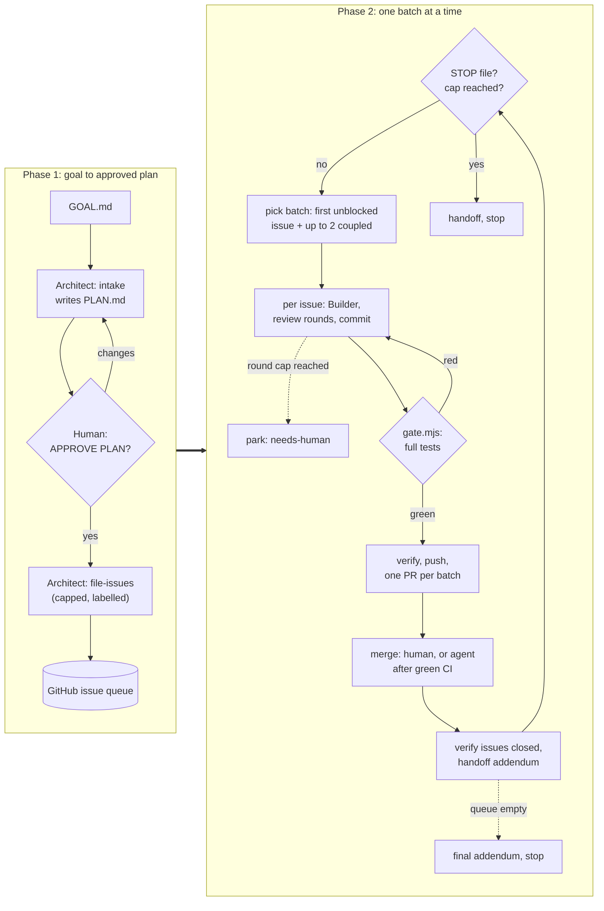
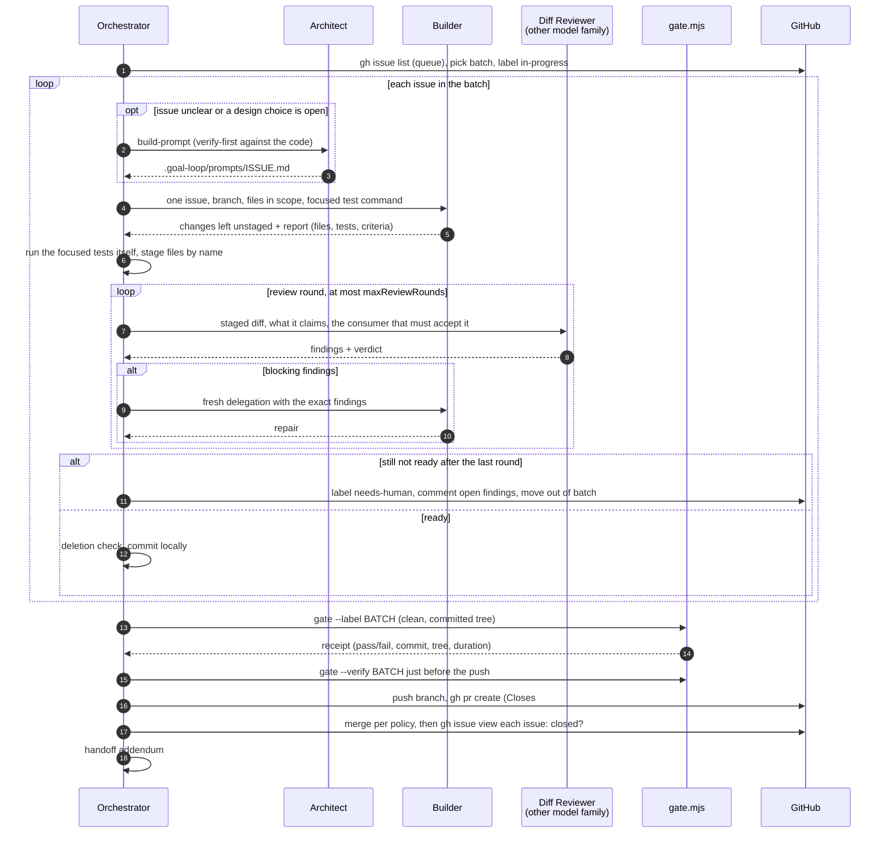
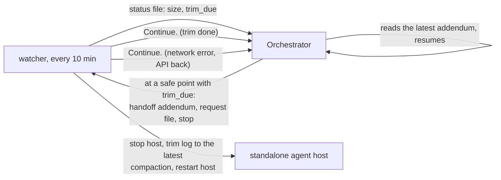

# Orchestrator map

How the goal loop works, from one goal to merged pull requests: who does what, in what order, what is checked where, and where a person comes in. Everything here is taken from the agent files in [templates/goal-loop](../templates/goal-loop/README.md); when this map and an agent file disagree, the agent file is what runs.

## The whole loop on one screen

## One batch in detail

## Roles

| Role | Model (default) | Does | Never |
|---|---|---|---|
| **Orchestrator** | `claude-sonnet-5.5` | Runs the loop: plan approval, batching, every delegation, focused-test check, staging, commits, the gate, push, PR, merge (if the policy allows), closure, handoff. | Pushes to the default branch, enables auto-merge, treats an automated "Continue." as plan approval. |
| **Architect** | `claude-sonnet-5.5` | `intake` (plan), `file-issues` (after approval), `build-prompt` (verify-first), `triage` (failures). | Edits code or tests, closes issues, pushes, merges. |
| **Builder** | `claude-sonnet-5.5` | Implements one issue with focused tests; repairs exactly the findings it is given. | Makes design decisions, adds dependencies, stages, commits, weakens a test. Stops and reports instead of guessing. |
| **Diff Reviewer** | `gpt-6.1-sol` (fallback `gpt-6-luna`) | Asks "does the next consumer accept this change?": renders what crosses the boundary, probes untested paths, checks that each test would fail without the fix. | Edits, stages or commits; approves because tests pass. |

The reviewer must be a different model family from the Builder; bootstrap refuses a same-family config. Models are passed explicitly on every delegation.

## Decision points

| When | The Orchestrator |
|---|---|
| Before every delegation, gate and push | Checks `.goal-loop/STOP`. If present: writes the handoff and stops. |
| Before each batch | Checks the caps (`maxBatchesPerRun`, `maxIssuesPerPlan`, `maxDiscoveredIssuesPerRun`). If one is reached: finishes the batch in hand, writes the handoff, stops. |
| The plan is shown | Waits. Only a human message containing `APPROVE PLAN` counts. |
| Picking a batch | Takes the first issue whose dependencies are closed, plus up to `maxBatchSize - 1` issues tightly coupled to it (a dependency, or the same files or interface). Never unrelated issues. |
| An issue is unclear | Asks the Architect for a verify-first build prompt instead of sending the issue straight to the Builder. |
| The Builder hits a hard stop | Sends it to the Architect for triage; a decision reserved for the human goes to the human. |
| Review finds a blocker or a repair regression | Fresh Builder delegation with the exact findings, then a delta review (a full review if a shared interface changed). |
| Review finds code the issue does not need (size) | Deletes it with the round's other repairs; from round 2 on, only leftovers the change itself made unused are deleted and other size findings go to the follow-up issue. A size-only repair that just removes code the change added runs the focused tests with no further review round. |
| Review round `maxReviewRounds` ends not ready | Parks the issue (`needs-human` label, comment with open findings and a recommendation) and continues with independent work. |
| The gate is red | Finds the issue that caused it, repairs, re-reviews, commits, gates again. |
| Merge policy `human` | Starts the next batch only if it doesn't depend on the unmerged PR; otherwise writes the handoff and waits with a watchdog. |
| Merge policy `agent-after-green` | Merges only after green CI checks and a receipt that matches the PR head. A repository with no CI is treated as `human`. |
| After a merge | Checks each issue's state; closes any GitHub missed, with a comment linking the PR. |
| Finding new problems | Files immediately only for security, data integrity or a blocker; everything else goes into one follow-up issue per batch. |
| No unparked issue left | Final addendum (what was built, PRs, receipts, review rounds, parked items, wall-clock time), then stops. |

## Where state lives

| State | Where | Read by |
|---|---|---|
| The goal | `.goal-loop/GOAL.md` | Architect (intake) |
| The plan and its approval | `.goal-loop/PLAN.md` (`Approved: <time>` at the top) | Orchestrator, Architect |
| The work queue | GitHub issues labelled `goal-loop`, `goal-loop:in-progress`, `goal-loop:needs-human` | Orchestrator |
| Build prompts | `.goal-loop/prompts/<issue>.md` | Builder |
| Gate receipts | `.goal-loop/receipts/<batch>.json` | Orchestrator (`--verify`), the PR description |
| Where the run is | `.goal-loop/handoff.md`: one addendum per batch, safe point and stop | A resumed or fresh Orchestrator |
| Settings | `.goal-loop/config.json` (models, gate command, caps, merge policy, labels) | Every agent |

A fresh session must be able to resume from the latest handoff addendum alone. That is what lets the same loop run as one long session or as a [Ralph loop](../templates/goal-loop/README.md#ralph-mode).

## Where a person comes in

1. **Writing the goal.**
2. **Approving the plan** with `APPROVE PLAN` (or `copilot-forever loop approve-plan` in Ralph mode).
3. **Merging PRs,** under the default `human` merge policy.
4. **Parked issues:** anything still not ready after the last review round, or a decision the standing orders reserve for a human (destructive data operations, weaker security, a breaking public interface, spending, credentials, production access, a change to the goal).
5. **Stopping it:** create `.goal-loop/STOP`; delete it and send `resume` to continue.

Everything else runs without you.

## What is enforced by code, and what by instructions

| Enforced by code | Enforced by the agents' instructions |
|---|---|
| `gate.mjs`: refuses a dirty tree, binds the receipt to the commit and tree, fails if tests change tracked files; `--verify` fails if anything changed before the push | Plan approval, caps, the STOP file |
| Bootstrap refuses a reviewer from the Builder's model family | Review before every commit, the round cap |
| GitHub branch protection (turn it on): PRs and passing checks for the default branch | PRs only, merge policy, closure check |
| Ralph mode: `--deny-tool` rules, `--max-ai-credits`, run caps, stall guard | Filing rules, escalation instead of guessing |

Turn on branch protection: it is the guard that holds even if an agent ignores its instructions.

## How the keep-alive kit fits in (persistent session)

The loop above runs inside one Orchestrator session. [copilot-forever](../README.md#the-keep-alive-kit) keeps that session going:

- **Safe point:** nothing the Orchestrator started is still running. Between batches is the natural one. The Orchestrator checks the status file there and requests a trim only when `trim_due` is true.
- **Network resume:** if a turn dies on a network error, the watcher sends a continue once the model API answers again (capped per error and per day).
- Both continue messages start with "Continue." and point at the handoff. Neither counts as plan approval.

In Ralph mode none of this is needed: each run is a fresh `copilot -p` process that reads the handoff and the issues, does one step, and exits.
