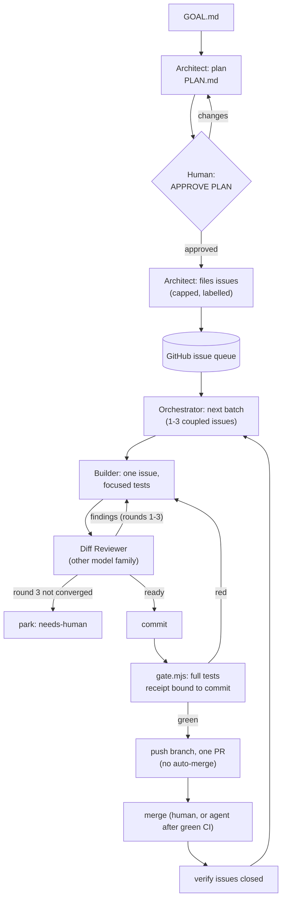

# The goal loop

A repeatable agentic loop that runs entirely in GitHub Copilot (VS Code's Agents window and the Copilot CLI). You give it a goal and approve one plan; it files GitHub issues and works them to merged pull requests, reviewing every change with a second model family and gating every batch with your own test suite. It runs in two modes: as one persistent Orchestrator session on [copilot-forever](../../README.md), which keeps going for hours or days across VS Code restarts and log trims, or as a [Ralph loop](#ralph-mode) of fresh `copilot -p` runs.



The [Orchestrator map](https://github.com/seangalliher/copilot-forever/blob/main/docs/orchestrator-map.md) has the full picture: one batch step by step, the roles, every decision point, where state lives and where a person comes in.

## What gets installed in your repository

| File | What it is |
|---|---|
| `.github/agents/orchestrator.agent.md` | Runs the loop: plan approval, batches, delegation, review rounds, gate, PRs, closure, handoff, stop file, caps, and copilot-forever's safe-point rule for log trims. |
| `.github/agents/architect.agent.md` | Goal intake (plan and issues with acceptance criteria and dependencies), verify-first build prompts, failure triage. Never edits code. |
| `.github/agents/builder.agent.md` | Implements one issue with focused tests. Makes no architectural decisions, never commits. |
| `.github/agents/diff-reviewer.agent.md` | Adversarial review of the staged diff: "does the next consumer accept this change?" Read-only tools. |
| `.github/copilot-instructions.md` | Shared standing orders: evidence standard, focused tests vs the gate, no `git add -A`, deletion check, faithful reporting, scope and escalation. If you already have this file, bootstrap leaves it alone and writes `.goal-loop/copilot-instructions.goal-loop.md` for you to merge. |
| `.goal-loop/config.json` | Models per role, gate command, caps, branch prefix, merge policy, labels. |
| `.goal-loop/gate.mjs` | The gate: runs `gate.command` on a clean committed tree and writes a receipt. No dependencies. |
| `.goal-loop/GOAL.md` | Your goal. Never overwritten by bootstrap. |
| `.goal-loop/handoff.md` | The handoff file; the Orchestrator appends an addendum after every batch and at every stop. |
| `.goal-loop/copilot-forever.config.json` | The keep-alive config for this repository. |
| `.goal-loop/.gitignore` | Keeps loop state (handoff, plan, receipts, STOP, trim files) out of the project. |

## Setup on a new machine

Prerequisites: Node 22+, Git, the GitHub CLI logged in (`gh auth login`), VS Code stable with `code` on PATH, GitHub Copilot. The target must be a Git repository with a GitHub remote and at least one commit.

Install the kit from npm, then run `setup` in your repository's folder:

```bash
npm install -g copilot-forever
```

```bash
copilot-forever setup
```

Setup checks the tools and says how to fix any that are missing. It then writes the files above, skipping any that already exist (`--force` re-renders them; `GOAL.md` is never overwritten), and prints the remaining steps:

1. Write the goal in `.goal-loop/GOAL.md`.
2. Check `.goal-loop/config.json` (models, `gate.command`, caps). After changing models, run setup again with `--force`.
3. Commit the scaffolding yourself and push it.
4. Protect the default branch: `copilot-forever protect`. GitHub then requires a pull request for every change to it, admins included. The agents push as you, so only GitHub can stop one pushing straight to it. On a private repository this needs a paid GitHub plan; public repositories get it free.
5. Start the keep-alive layer: `copilot-forever doctor`, `install`, `host start`, each with `--config .goal-loop/copilot-forever.config.json`.
6. Add the standalone host to VS Code's `chat.remoteAgentHosts` setting (address `localhost:<port>`, token from `~/.copilot-forever/token.txt`).
7. In the Agents window, start a session on that host with the **Goal Orchestrator** agent, set the effort in the chat's model picker to `effort.orchestrator` (High by default), and send `start` (or paste the goal).
8. Reply `APPROVE PLAN` when the plan is right.

Steps 5 to 8 are the persistent session. `setup --start` does step 5 for you (it schedules the watcher and starts the host). For [Ralph mode](#ralph-mode), skip steps 5 to 8 and run `copilot-forever loop --mode ralph` instead.

Preview everything first with `--dry-run`, which writes nothing. `npx copilot-forever setup` also works without installing anything, except for `--start` and the keep-alive schedule: the schedule runs the kit from where it is installed, so it needs `npm install -g`. From a clone, `node copilot-forever/bootstrap.mjs --repo path/to/your-repo` does the same as setup, plus `npm ci` and `npm link` in the clone. `copilot-forever goal-loop --repo <path>` is the older name for setup.

## Configuration (`.goal-loop/config.json`)

| Key | Default | Meaning |
|---|---|---|
| `models.orchestrator` / `architect` / `builder` | `claude-sonnet-5.5` (all three) | Written into each agent's `model:` line and passed explicitly on every delegation. |
| `models.reviewer` / `reviewerFallback` | `gpt-6.1-sol` / `gpt-6-luna` | Must be a different model family from the builder; bootstrap refuses otherwise (`--allow-same-family` overrides, not recommended). |
| `effort.orchestrator` | `high` | The Orchestrator is the main session: set this level in the chat's model picker (persistent mode); Ralph mode passes it as `--reasoning-effort`. |
| `effort.architect` / `builder` / `reviewer` | `max` / `high` / `max` | Reasoning effort per subagent. The bootstrap writes them to Copilot's user settings (`~/.copilot/settings.json`, `subagents.agents.<agent name>.effortLevel`), touching only the kit's own agent names and keeping your file as it was before the first change as `settings.json.bak-copilot-forever`. An agent file kept with an older name (a rerun without `--force`) gets no entry and a warning. `--no-effort` (on `bootstrap.mjs` and `copilot-forever goal-loop`) skips this; `/subagents` changes it by hand. Levels: `none`, `minimal`, `low`, `medium`, `high`, `xhigh`, `max`, or `inherit` (the parent session's). Max where judgement is the product (the plan, the review), High where the spec and the review carry the quality (building, coordinating). |
| `agents.namePrefix` | `Goal ` | Prefix for the agents' names: Goal Orchestrator, Goal Architect, Goal Builder, Goal Diff Reviewer. Copilot keys the effort settings by agent name for the whole user, so the prefix keeps them apart from agents of the same name in your other repositories. |
| `gate.command` | `npm test` | Your repository's full test command. |
| `gate.timeoutMinutes` | `30` | The gate fails when the command runs longer. |
| `tests.focused` | `npm test -- <test file>` | How the Builder runs focused tests; shown in briefs. |
| `caps.maxIssuesPerPlan` | `12` | At most this many issues filed from one plan. |
| `caps.maxBatchesPerRun` | `8` | The Orchestrator stops after this many batches and writes a handoff. |
| `caps.maxBatchSize` | `3` | At most this many tightly coupled issues per batch (3 or less). |
| `caps.maxReviewRounds` | `3` | After this many review rounds the issue is parked for a human. |
| `caps.maxDiscoveredIssuesPerRun` | `3` | New issues the loop may file for problems it finds along the way. |
| `github.branchPrefix` | `goal-loop/` | Batch branches. The loop never pushes to the default branch. |
| `github.mergePolicy` | `human` | `human`: you merge PRs. `agent-after-green`: the Orchestrator merges its own PR after green CI checks and a matching gate receipt (never auto-merge, never admin). |
| `github.labels` | `goal-loop`, `goal-loop:in-progress`, `goal-loop:needs-human` | The queue, the batch in progress, and parked issues. |
| `keepAlive.port` / `thresholdMiB` | `47801` / `400` | Written into the copilot-forever config. |

## Safe defaults

- **One human approval** of the plan before any issue is filed. Only a message containing `APPROVE PLAN` counts; the automatic "Continue." message after a log trim never does.
- **Caps** on issues filed, batches per run, batch size and review rounds.
- **STOP file**: create `.goal-loop/STOP` and the Orchestrator writes a handoff and stops before its next delegation, gate or push. Delete it and send `resume` to continue.
- **PRs only**: work happens on `goal-loop/…` branches; nothing is pushed to the default branch, and auto-merge is never enabled. By default you merge.
- **Reviewer on another model family**, on every change, before every commit.
- **One receipted gate per batch**: `gate.mjs` refuses a dirty tree, binds the result to the commit and tree, fails if the tests change tracked files, and `--verify` fails if anything changed before the push.
- **Escalation, not guessing**, for destructive data operations, weaker security, breaking public interfaces, spending, credentials, production access or a changed goal.

## The gate

```bash
node .goal-loop/gate.mjs --label batch-3
```

```bash
node .goal-loop/gate.mjs --verify batch-3
```

The first runs the full test command and writes `.goal-loop/receipts/batch-3.json` (result, commit, tree, command, exit code, duration, a hash of the output, the log path and its tail). The second exits 0 only if that receipt passed for the current `HEAD` and the tree is still clean. Exit codes: 0 pass, 1 tests failed, 2 usage or config error, 3 refused (dirty tree or no commit), 4 verify failed.

## Ralph mode

The same agents and standing orders also run as a Ralph loop: an outer runner starts a fresh, non-interactive `copilot -p` Orchestrator for each step, and the handoff file and the GitHub issues carry the state between runs. It does not need the standalone host, the log trim or the Agent Host Protocol. See [Persistent session or Ralph loop?](../../README.md#persistent-session-or-ralph-loop) for the trade-off.

```bash
copilot-forever loop --mode ralph --repo path/to/your-repo --dry-run
```

```bash
copilot-forever loop --mode ralph --repo path/to/your-repo
```

Each run is one step, chosen by the runner from the files and the queue:

| State | Step for this run |
|---|---|
| No `.goal-loop/PLAN.md` | **plan**: the Architect writes the plan; the runner then stops and waits for you. |
| A plan you have not approved, or one changed since you approved it | Stop: read the plan, then run `copilot-forever loop approve-plan --repo <path>` (or edit `GOAL.md`, delete `PLAN.md`, and run again for a new plan). |
| Approved plan, no goal-loop issues yet | **file**: the Architect files the issues (capped). |
| Open goal-loop issues that are not parked | **batch**: at most one batch (build, review rounds, gate, PR, merge policy, closure), then a handoff addendum. |
| Every goal-loop issue closed or parked | Stop: done. |

The runner stops when the STOP file exists, when the queue is done, at `ralph.maxIterations` runs or `caps.maxBatchesPerRun` batch runs, or when `ralph.stallLimit` runs in a row touch no issue and no PR (the stall guard). With `mergePolicy: human`, a batch that waits on your merge makes no progress, so the stall guard stops the loop until you merge and run it again.

**Each run's command line** pins the agent and the model, and points the prompt at a file the runner writes:

```text
copilot -p "Ralph mode: read .goal-loop/ralph/run-003-batch-<time>.prompt.md and follow it exactly."
        --agent "Goal Orchestrator" --model <models.orchestrator> --reasoning-effort <effort.orchestrator>
        --allow-all-tools --no-ask-user --no-auto-update
        --deny-tool=<each ralph.denyTools entry>  [--deny-tool=shell(gh pr merge) when mergePolicy is human]
        [--max-ai-credits <ralph.maxAiCreditsPerRun>]
        --usage-output-file .goal-loop/ralph/<run>.usage.json --share .goal-loop/ralph/<run>.transcript.md
```

The Orchestrator then delegates to the Architect, Builder and Diff Reviewer with their own models, as in the persistent session.

**Logs**, all under `.goal-loop/ralph/` (gitignored): `runs.jsonl` has one line per run (step, start, end, exit code, timed out, issues and PRs touched, open issues before and after, progress), plus each run's output log, usage file and transcript. `runner.log` has the runner's own lines.

### Permissions: read this before the first run

Non-interactive Copilot runs cannot ask you to approve a tool, so the CLI requires `--allow-all-tools`: **every run may execute any shell command and edit any file the agent decides to**, without asking. Deny rules (`ralph.denyTools`) are checked first and block what they match, but they are a seatbelt, not a boundary: a command can be phrased many ways. Treat a Ralph loop like an unattended CI job with your credentials:

- Run it in a sandbox: a dev container, a VM, or a dedicated user account with only this repository checked out.
- Give it a GitHub token scoped to this one repository (a fine-grained token for `gh`), not your everyday login.
- Keep secrets out of the environment, and out of the repository.
- Turn on branch protection for the default branch (require a PR and passing checks), so even a misbehaving run cannot push to it.
- Cap spend with `ralph.maxAiCreditsPerRun` and the run caps, and watch your Copilot usage on the first runs.

The runner drops a few variables of whatever started it (other tools' session variables, `VSCODE_IPC_HOOK*`, `ELECTRON_RUN_AS_NODE`, `NODE_OPTIONS`) before starting `copilot`; everything else in your environment reaches the agent.

| Key (`ralph.…`) | Default | Meaning |
|---|---|---|
| `copilotCommand` / `ghCommand` | `copilot` / `gh` | The CLIs, as a command name or `[executable, ...args]`. |
| `agent` | the Orchestrator's name (`Goal Orchestrator`) | The `--agent` value; leave it out unless you renamed the agent by hand. |
| `maxIterations` | `12` | Runs per invocation of the loop. |
| `stallLimit` | `3` | Consecutive runs without progress before the loop stops. |
| `iterationTimeoutMinutes` | `120` | A run that takes longer is stopped. |
| `pauseSeconds` | `30` | Pause between runs. |
| `maxAiCreditsPerRun` | `0` (no limit) | Passed as `--max-ai-credits` (the CLI minimum is 30). |
| `denyTools` | `gh repo delete`, `gh repo edit`, `gh secret`, `gh auth`, `git push --force` | Each passed as `--deny-tool=shell(...)`. |
| `extraArgs` | `[]` | More `copilot` flags. |

## Where the time went

After a run, or during one, the timing report reads the session's own log and shows where the time went:

```bash
copilot-forever report --config .goal-loop/copilot-forever.config.json
copilot-forever report --session <session-id or path to events.jsonl> --out timing.md
```

It puts every minute of the session in one bucket: subagents working, the Orchestrator between them, waiting for a message or an answer (from you or the watcher, so a stall the watcher ended shows here unless a background subagent was running), waiting on background commands or sleeps, quiet (5+ minutes the log does not explain, often a stall), and stopped. Then it gives per-role totals and one row per subagent run with its effort, model time, tool calls and tokens, and Copilot's usage figures. Trim archives of the session are read too, so a trimmed session reports from its start. For a session still running, the report runs up to its latest event. `--json` gives the same data for scripts.

Use it before you change effort levels, batch sizes or review rounds: tune the step that took the time. In Ralph mode each run is its own session; report on them one at a time.

## What this pattern deliberately leaves out

It is distilled from a loop that ran a large project for months; the parts that only made sense there are gone:

- **A second agent product.** Everything runs in GitHub Copilot; there is no external Architect bridge.
- **Project numbering schemes, trackers and roadmaps.** GitHub issues are the only queue and the only record.
- **Backlog accounting** (net issue reduction, discovery budgets per closure). Replaced by a single cap on discovered issues.
- **Autonomous decision authority beyond the plan.** The loop does not make product decisions the plan does not cover; it parks and asks.
- **Prompt-cache timing trials and token-economy measurements.** Useful at scale, but tied to one project's numbers. The timing report above covers the everyday question: where did the time go?

## Try it

[The LoopBoard demo](https://github.com/seangalliher/copilot-forever/blob/main/demo/README.md) builds a local-first kanban board from an empty repository in a few hours of loop time, in either mode.
