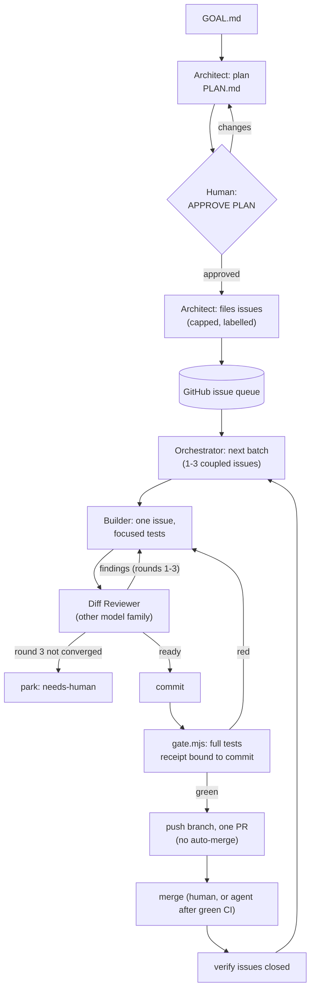

# The goal loop

A repeatable agentic loop that runs entirely in GitHub Copilot (VS Code's Agents window and the Copilot CLI). You give it a goal and approve one plan; it files GitHub issues and works them to merged pull requests, reviewing every change with a second model family and gating every batch with your own test suite. It runs on [copilot-forever](../../README.md), so one Orchestrator session keeps going for hours or days, across VS Code restarts and log trims.



## What gets installed in your repository

| File | What it is |
|---|---|
| `.github/agents/orchestrator.agent.md` | Runs the loop: plan approval, batches, delegation, review rounds, gate, PRs, closure, handoff, stop file, caps, and copilot-forever's safe-point rule for log trims. |
| `.github/agents/architect.agent.md` | Goal intake (plan and issues with acceptance criteria and dependencies), verify-first build prompts, failure triage. Never edits code. |
| `.github/agents/builder.agent.md` | Implements one issue with focused tests. Makes no architectural decisions, never commits. |
| `.github/agents/diff-reviewer.agent.md` | Adversarial review of the staged diff: "does the next consumer accept this change?" Read-only tools. |
| `.github/copilot-instructions.md` | Shared standing orders: evidence standard, focused tests vs the gate, no `git add -A`, deletion check, faithful reporting, scope and escalation. If you already have this file, bootstrap leaves it alone and writes `.goal-loop/copilot-instructions.goal-loop.md` for you to merge. |
| `.goal-loop/config.json` | Models per role, gate command, caps, branch prefix, merge policy, labels. |
| `.goal-loop/gate.mjs` | The gate: runs `gate.command` on a clean committed tree and writes a receipt. No dependencies. |
| `.goal-loop/GOAL.md` | Your goal. Never overwritten by bootstrap. |
| `.goal-loop/handoff.md` | The handoff file; the Orchestrator appends an addendum after every batch and at every stop. |
| `.goal-loop/copilot-forever.config.json` | The keep-alive config for this repository. |
| `.goal-loop/.gitignore` | Keeps loop state (handoff, plan, receipts, STOP, trim files) out of the project. |

## Setup on a new machine

Prerequisites: Node 22+, Git, the GitHub CLI logged in (`gh auth login`), VS Code stable with `code` on PATH, GitHub Copilot. The target must be a Git repository with a GitHub remote and at least one commit.

One command clones the kit, installs it and renders the loop into your repository:

```bash
git clone https://github.com/seangalliher/copilot-forever.git && node copilot-forever/bootstrap.mjs --repo path/to/your-repo
```

Bootstrap checks the tools, runs `npm ci` and `npm link` in the kit, writes the files above (skipping any that exist; `--force` re-renders them, `GOAL.md` is never overwritten), and prints the remaining manual steps:

1. Write the goal in `.goal-loop/GOAL.md`.
2. Check `.goal-loop/config.json` (models, `gate.command`, caps). After changing models, run bootstrap again with `--force`.
3. Commit the scaffolding yourself.
4. Start the keep-alive layer: `copilot-forever doctor`, `install`, `host start`, each with `--config .goal-loop/copilot-forever.config.json`.
5. Add the standalone host to VS Code's `chat.remoteAgentHosts` setting (address `localhost:<port>`, token from `~/.copilot-forever/token.txt`).
6. In the Agents window, start a session on that host with the **Orchestrator** agent and send `start`.
7. Reply `APPROVE PLAN` when the plan is right.

Preview everything first with `--dry-run`, which writes nothing. The same bootstrap is available as `copilot-forever goal-loop --repo <path> [--goal-config <file>]` once the kit is installed.

## Configuration (`.goal-loop/config.json`)

| Key | Default | Meaning |
|---|---|---|
| `models.orchestrator` / `architect` / `builder` | `claude-sonnet-5.5` / `claude-opus-5.5` / `claude-sonnet-5.5` | Written into each agent's `model:` line and passed explicitly on every delegation. |
| `models.reviewer` / `reviewerFallback` | `gpt-6.1-sol` / `gpt-6-luna` | Must be a different model family from the builder; bootstrap refuses otherwise (`--allow-same-family` overrides, not recommended). |
| `gate.command` | `npm test` | Your repository's full test command. |
| `gate.timeoutMinutes` | `30` | The gate fails when the command runs longer. |
| `tests.focused` | `npm test -- <test file>` | How the Builder runs focused tests; shown in briefs. |
| `caps.maxIssuesPerPlan` | `12` | At most this many issues filed from one plan. |
| `caps.maxBatchesPerRun` | `8` | The Orchestrator stops after this many batches and writes a handoff. |
| `caps.maxBatchSize` | `3` | At most this many tightly coupled issues per batch (3 or less). |
| `caps.maxReviewRounds` | `3` | After this many review rounds the issue is parked for a human. |
| `caps.maxDiscoveredIssuesPerRun` | `3` | New issues the loop may file for problems it finds along the way. |
| `github.branchPrefix` | `goal-loop/` | Batch branches. The loop never pushes to the default branch. |
| `github.mergePolicy` | `human` | `human`: you merge PRs. `agent-after-green`: the Orchestrator merges its own PR after green CI checks and a matching gate receipt (never auto-merge, never admin). |
| `github.labels` | `goal-loop`, `goal-loop:in-progress`, `goal-loop:needs-human` | The queue, the batch in progress, and parked issues. |
| `keepAlive.port` / `thresholdMiB` | `47801` / `400` | Written into the copilot-forever config. |

## Safe defaults

- **One human approval** of the plan before any issue is filed. Only a message containing `APPROVE PLAN` counts; the automatic "Continue." message after a log trim never does.
- **Caps** on issues filed, batches per run, batch size and review rounds.
- **STOP file**: create `.goal-loop/STOP` and the Orchestrator writes a handoff and stops before its next delegation, gate or push. Delete it and send `resume` to continue.
- **PRs only**: work happens on `goal-loop/…` branches; nothing is pushed to the default branch, and auto-merge is never enabled. By default you merge.
- **Reviewer on another model family**, on every change, before every commit.
- **One receipted gate per batch**: `gate.mjs` refuses a dirty tree, binds the result to the commit and tree, fails if the tests change tracked files, and `--verify` fails if anything changed before the push.
- **Escalation, not guessing**, for destructive data operations, weaker security, breaking public interfaces, spending, credentials, production access or a changed goal.

## The gate

```bash
node .goal-loop/gate.mjs --label batch-3
```

```bash
node .goal-loop/gate.mjs --verify batch-3
```

The first runs the full test command and writes `.goal-loop/receipts/batch-3.json` (result, commit, tree, command, exit code, duration, a hash of the output, the log path and its tail). The second exits 0 only if that receipt passed for the current `HEAD` and the tree is still clean. Exit codes: 0 pass, 1 tests failed, 2 usage or config error, 3 refused (dirty tree or no commit), 4 verify failed.

## What this pattern deliberately leaves out

It is distilled from a loop that ran a large project for months; the parts that only made sense there are gone:

- **A second agent product.** Everything runs in GitHub Copilot; there is no external Architect bridge.
- **Project numbering schemes, trackers and roadmaps.** GitHub issues are the only queue and the only record.
- **Backlog accounting** (net issue reduction, discovery budgets per closure). Replaced by a single cap on discovered issues.
- **Autonomous decision authority beyond the plan.** The loop does not make product decisions the plan does not cover; it parks and asks.
- **Model-usage auditing from the session log, prompt-cache timing trials and token-economy measurements.** Useful at scale, but tied to an internal log format and to one project's numbers.

## Try it

[The Pocket Board demo](../../demo/README.md) builds a small browser app from an empty repository in a few hours of loop time.
